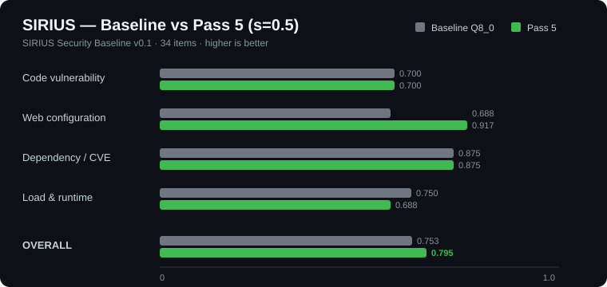
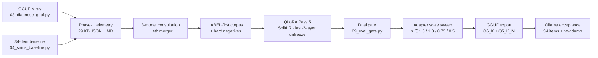

<div align="center">

# SIRIUS

### Local-first security auditing on a 0.5B model — measured, diagnosed, and fine-tuned end-to-end

[](https://python.org)
[](LICENSE)
[](https://huggingface.co/Qwen/Qwen2.5-0.5B-Instruct)
[](https://ollama.com)
[](https://colab.research.google.com)
[](docs/04-final-results.md)

**34-item security baseline · 0.753 → 0.795 overall · code-vuln label errors 5/5 → 1/5 · dual PPL gate passed**

> **Shipped model:** `sirius-final` (Pass 5). Later Phase 5/6 "head of security" experiments
> are quarantined in [experiments/FAILED-NOT-SHIPPED/](experiments/FAILED-NOT-SHIPPED/README.md),
> and the Stage B broader-base candidate failed a ship gate — **neither is part of this deliverable**.

</div>

---

## The problem

Small local models can be surprisingly good at security questions — until they confidently name the *wrong* vulnerability. In our baseline, `Qwen2.5-0.5B-Instruct` called a hardcoded API key a *buffer overflow*, described `verify=False` as *XSS*, and hallucinated stack overflows from `eval()`. Increasing model capacity 8× (r=8 → r=64 LoRA) barely moved the needle. The failure was not size. It was **label mapping, keyword placement, and training-data distribution**.

SIRIUS is the full investigation: a measurement-first diagnostic, a multi-model consultation, five training passes, and a final model that passes the acceptance gate — with every decision traceable to a number in a reported file.



---

## Results at a glance

| Capability | Baseline (Q8_0) | Pass 5 (s=0.5) | Δ |
|---|---:|---:|---:|
| Code vulnerability scanning | 0.700 | **0.700** | 0.000 |
| Web configuration & policy | 0.688 | **0.917** | **+0.229** |
| Dependency & CVE awareness | 0.875 | **0.875** | 0.000 |
| Load & runtime testing | 0.750 | 0.688 | −0.062 *(within ±0.25 noise band, n=8)* |
| **Overall** | **0.753** | **0.795** | **+0.042** |
| V02–V06 correct canonical labels | 1/5 | **4/5** | +3 |
| General PPL ratio vs base | — | **0.923** | gate < 1.30 ✓ |

> Full acceptance table, per-item dumps, and the honest caveats live in [docs/04-final-results.md](docs/04-final-results.md).

**Held-out stress test (Phase 4a).** A separate 104-item eval with novel snippets gives
baseline 0.310 vs Sirius 0.255; McNemar exact **p = 0.3616 → not significant**. So the win is
real on the fixed SIRIUS suite, but the two models are statistically indistinguishable on
unseen phrasings — reported openly in [docs/05-eval100-result.md](docs/05-eval100-result.md).

**Post-quantization check (Phase 4b).** On an identical wikitext slice with one tool,
PPL(base Q8_0) = 15.68 and PPL(shipped Q6_K) = 14.71 → ratio **0.938 ≤ 1.05 → PASS**. Details
and the measurement caveats: [docs/06-ppl-recheck.md](docs/06-ppl-recheck.md).

**Security-lead layer (research, not shipped).** `security-lead/` adds the Head-of-Security
role, 9 SDLC playbooks, a 110-item capability eval, and `sirius_cli.py` — a deterministic CI
gate with **dynamic context routing** (only the relevant playbook is injected into a 0.5B's
context), conservative decoding (`min_p=0.05`, `repeat_penalty=1.1`), syntax anchors and an
explicit restraint rule. Two training attempts improved the capability score (0.127 → 0.419)
and restraint (0 → 12/20) but both missed the pre-registered bars, so **none of this is part
of the deployed model**. Full audit trail: [experiments/FAILED-NOT-SHIPPED/](experiments/FAILED-NOT-SHIPPED/README.md).

**External benchmark (CyberSecEval-derived, preregistered).** To avoid grading only our own
homework, we ran 351 third-party CyberSecEval Python snippets as a vulnerability-identification
test, shipped model vs stock. Result is honest but mixed: Sirius **0.225** vs stock **0.288**
micro accuracy (McNemar **p = 0.0467**, a significant *loss*), while on secure-code restraint
Sirius abstained **3.6%** vs stock **0%**. Gains concentrated in SQLi/hardcoded secrets; losses
in eval/exec, PRNG and weak hashes. **This is not the official CyberSecEval score** and no ship
decision was attached. Prereg [docs/13-cyberseceval-prereg.md](docs/13-cyberseceval-prereg.md),
full result [docs/14-cyberseceval-result.md](docs/14-cyberseceval-result.md),
raw answers [results/cyberseceval_derived.json](results/cyberseceval_derived.json).

**Broader-base experiment (Stage B, not shipped).** We tested whether the base model was the
bottleneck. Stock `Qwen2.5-Coder-1.5B` scored **0.501** on the same external identification test
(vs stock 0.5B's 0.288, McNemar p≈1e-40) and **0.902** on suite34, but never abstained on secure
code (0%). After a prereg amendment moving restraint to a *post-training* gate
([docs/17-stage-a-result-and-amendment.md](docs/17-stage-a-result-and-amendment.md)), we ported
the **unmodified Pass 5 recipe** onto that base on a Kaggle T4 x2: training PPL gate **0.835
PASS**, dual gate passed at all scales, chosen s=1.0, Q6_K/Q5_K_M GGUFs exported locally.
Acceptance suite34: **0.912 overall**, but code-vuln **0.900 → 0.650** — a ship-gate failure.
The co-primary external test on the trained model was still running at the time of this update.
**Not shipped:** `sirius-final` remains deployed. Prereg
[docs/15-base-model-ab-prereg.md](docs/15-base-model-ab-prereg.md),
[docs/16-stage-b-prereg.md](docs/16-stage-b-prereg.md),
run notebook [notebooks/stage_b_coder15.ipynb](notebooks/stage_b_coder15.ipynb).

---

## How it works



**Four layers of evidence, each produced by a script in this repo:**

1. **File & architecture telemetry** — every tensor, per-block parameter budget, Q4_K_M vs Q8_0 delta (GGUF parsed with the `gguf` Python package, never guessed).
2. **Behavioral telemetry** — a fixed 34-item security suite with transparent keyword-group scoring, run identically before and after.
3. **Consultation & merge** — three independent AI reviewers argued over rank, modules, pruning and data; a fourth resolved every disagreement against telemetry numbers.
4. **Failure-mode diagnosis** — raw generations were dumped and auto-classified as `WRONG_LABEL` / `TRUNCATED_SUSPECT` / `GRADER_MISS` / `HEDGE` / `PASS` before any retraining.

---

## Repository structure

```
SIRIUS-Security-Audit/
├── README.md                        ← you are here
├── LICENSE                          MIT
├── configs/
│   ├── Modelfile.sirius             Ollama definition for the final GGUF
│   └── SIRIUS_Phase2_Colab.ipynb    7-cell notebook used on the T4
├── data/
│   ├── sirius_train_pass5.jsonl     3,358 LABEL-first ChatML items
│   ├── sirius_dev.jsonl             100 held-out dev items
│   ├── sirius_train_pass5_manifest.json
│   ├── sirius_train_contrastive.jsonl
│   └── eval100_items.json                  104 held-out acceptance items
├── docs/
│   ├── 01-diagnostic-telemetry.md   phase-1 "before" snapshot
│   ├── 02-consultation-merge.md     three seats + fourth-seat merge
│   ├── 03-phase2-runbook.md         configs, escalation ladder
│   ├── 04-final-results.md          acceptance table + verdict
│   ├── 05-eval100-result.md         104-item held-out eval + McNemar test
│   ├── 06-ppl-recheck.md            post-quantization PPL gate (local CPU)
│   ├── 13-cyberseceval-prereg.md    external benchmark, frozen before running
│   ├── 14-cyberseceval-result.md    mixed result, reported as-is
│   ├── 15-base-model-ab-prereg.md   base-model A/B, frozen before running
│   ├── 16-stage-b-prereg.md         Stage B recipe + ship gates
│   ├── 17-stage-a-result-and-amendment.md   mixed Stage A result + prereg fix
│   ├── taxonomy.md                  canonical LABEL contract per archetype
│   └── development-log.md           session-to-session status and bug fixes
├── experiments/
│   └── FAILED-NOT-SHIPPED/          ⛔ quarantined failed Phase 5/6 attempts
│       └── README.md                why they failed + the shipped result for contrast

├── scripts/
│   ├── 00_check_setup.py … 05_compare_models.py    diagnostic toolkit
│   ├── 04b_run_eval100.py                           104-item eval + McNemar
│   ├── 06_build_dataset.py                          corpus assembly
│   ├── 15_build_eval_expanded.py                    eval100 builder
│   ├── 16_ppl_recheck_gguf.py                       post-quant PPL gate
│   ├── 07_train_colab.py                            Pass 5 trainer (SplitLR)
│   ├── 08_prune_quantize_colab.py                   ShortGPT / GGUF export
│   ├── 09_eval_gate.py                              dual gate + scale sweep
│   ├── 10_remerge_scaled.py                         re-merge at chosen scale
│   ├── 11_export_gguf.py                            lean llama.cpp export
│   ├── 13_dump_raw_outputs.py                       failure-mode classifier
│   ├── 24_cyberseceval_derived.py                   external benchmark runner
│   ├── 25_base_ab_decision.py                       mechanical Stage A gate
│   ├── 26_merge_stageb_local.py                     local PEFT merge for Stage B
│   └── build_sirius_report.py                       telemetry report builder
├── reports/
│   ├── results.svg                  baseline vs final chart
│   ├── telemetry/SIRIUS_Telemetry_Report.json
│   ├── gates/                       train + gate logs (Pass 5)
│   └── dumps/                       raw output dumps (s=1.0 and s=0.5)
├── results/
│   ├── cyberseceval_derived.json    external benchmark: raw answers + scores
│   ├── cyberseceval_derived_coder15.json   base-model A/B candidate run
│       (stageb external test JSON is written when the run completes)
├── notebooks/
│   └── stage_b_coder15.ipynb        Kaggle T4 x2 training notebook
└── models/README.md                 where to download the GGUFs
```

> The trained GGUFs are **not committed** — they are 420–506 MB and GitHub caps files at 100 MB. Download links and `ollama create` instructions are in [models/README.md](models/README.md).

---

## Quick start — run the final model

```bash
# 1. Download sirius_final_Q6_K.gguf (link in models/README.md) next to Modelfile.sirius
cd configs

# 2. Create the Ollama model
ollama create sirius-final -f Modelfile.sirius

# 3. Ask it something
ollama run sirius-final \
  "Review this Python code for security issues and name the exact vulnerability:
   API_KEY = 'sk-live-9f2c7d88ab'
   def call(): return requests.post(URL, headers={'Authorization': API_KEY})"
```

Expected opening line: `LABEL: hardcoded secret — embedded credential in source code`.

---

## Reproduce the training

Everything ran on a **free Colab T4**. Open `configs/SIRIUS_Phase2_Colab.ipynb`, connect a GPU runtime, and run the cells in order. The exact commands are in [docs/development-log.md](docs/development-log.md); the short version:

```bash
pip install -U transformers==4.46.0 peft==0.13.0 accelerate==1.1.1 trl==0.12.0
pip install -U bitsandbytes          # 0.44.1 lacks CUDA-13 binaries

python 07_train_colab.py --pass-name pass5 \
       --train sirius_train_pass5.jsonl --skip-install-check
python 09_eval_gate.py --merged ./sirius_merged_pass5 \
       --adapter ./sirius_lora_adapter_pass5 --dev sirius_dev.jsonl \
       --tag pass5 --scales "1.5,1.0,0.75,0.5"
python 11_export_gguf.py --merged ./sirius_merged_pass5 --base-name sirius_final
```

**Pass 5 config** — attention-only LoRA on layers 4–20, `r=16`, `α=16` (rsLoRA), bf16 base, lr `3e-5` adapter / `1e-6` on the last two unfrozen base layers, 2 epochs, completion-only loss, 10% wikitext anchor, composite early stopping.

---

## What we learned (the part most write-ups skip)

| Finding | Evidence | Consequence |
|---|---|---|
| Rank was never the bottleneck | r=8 → r=64 moved code_vuln 0.350 → 0.550 | Stopped scaling adapters; changed data and loss |
| PPL percentages lie | ln(306)=5.72 → ln(2576)=7.85 is +2.13 nats, not "+740%" | Gates re-expressed as **ratio < 1.30** on clean wikitext |
| LABEL line position decides the score | grader is keyword-group based; tail truncation ate the old label | LABEL-first answer contract in `docs/taxonomy.md` |
| One `min_pass=2` item is the canary | V05 (weak hash) was the only V-item fixed by early passes | It needs *both* problem and fix keywords — verify coverage, not vibes |
| Keyword stuffing is a real failure mode | s=1.0 emitted `LABEL: pypandoc, pyproject.lock, coverage, linter` | Inference-time scale sweep rescued it at s=0.5, no retraining |
| Hard negatives teach restraint | matched safe snippets labelled `no vulnerability found` | Over-labelling on security-themed code stopped |

Six toolkit bugs were found and fixed along the way (bitsandbytes/CUDA-13, TRL label padding, PPL corpus, 60 GB KL cache, an infinite `base_model` property loop, and a stale `get_parameter_names` signature). All are documented in [docs/development-log.md](docs/development-log.md) so they are not rediscovered.

---

## Limitations

- **Load testing** is the one capability below its strict baseline threshold (0.688 vs 0.750). With 8 items, one answer moves the score by 0.125; a 100+ item eval is needed before treating this as real.
- **Perplexity** is measured on wikitext-2-raw; it is a retention proxy, not a security-quality metric. The dual gate also tracks security loss, KL and token accuracy.
- **0.5B is small.** This is a local-first, air-gapped assistant for triage — not a replacement for a full scanner.
- **L04** in the baseline suite is mathematically unpassable (`min_pass=2` with one keyword group). Its raw mean is unaffected; pass-rate is not.

---

## Citation

If this helps your work:

```bibtex
@misc{sirius2026,
  title  = {SIRIUS: Measurement-driven fine-tuning of a 0.5B local security auditor},
  author = {Tayyab Ahmed},
  year   = {2026},
  url    = {https://github.com/tayyabahmadq/SIRIUS-Security-Audit}
}
```

---

<div align="center">

Built with Python, PEFT, Ollama, llama.cpp, and a refusal to trust a number that wasn't read from a file.

[](LICENSE)

</div>
