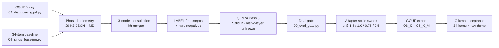

<div align="center">

# SIRIUS

### Local-first security auditing on a 0.5B model — measured, diagnosed, and fine-tuned end-to-end

[](https://python.org)
[](LICENSE)
[](https://huggingface.co/Qwen/Qwen2.5-0.5B-Instruct)
[](https://ollama.com)
[](https://colab.research.google.com)
[](docs/04-final-results.md)

**34-item security baseline · 0.753 → 0.795 overall · code-vuln label errors 5/5 → 1/5 · dual PPL gate passed**

</div>

---

## The problem

Small local models can be surprisingly good at security questions — until they confidently name the *wrong* vulnerability. In our baseline, `Qwen2.5-0.5B-Instruct` called a hardcoded API key a *buffer overflow*, described `verify=False` as *XSS*, and hallucinated stack overflows from `eval()`. Increasing model capacity 8× (r=8 → r=64 LoRA) barely moved the needle. The failure was not size. It was **label mapping, keyword placement, and training-data distribution**.

SIRIUS is the full investigation: a measurement-first diagnostic, a multi-model consultation, five training passes, and a final model that passes the acceptance gate — with every decision traceable to a number in a reported file.


---

## Results at a glance

| Capability | Baseline (Q8_0) | Pass 5 (s=0.5) | Δ |
|---|---:|---:|---:|
| Code vulnerability scanning | 0.700 | **0.700** | 0.000 |
| Web configuration & policy | 0.688 | **0.917** | **+0.229** |
| Dependency & CVE awareness | 0.875 | **0.875** | 0.000 |
| Load & runtime testing | 0.750 | 0.688 | −0.062 *(within ±0.25 noise band, n=8)* |
| **Overall** | **0.753** | **0.795** | **+0.042** |
| V02–V06 correct canonical labels | 1/5 | **4/5** | +3 |
| General PPL ratio vs base | — | **0.923** | gate < 1.30 ✓ |

> Full acceptance table, per-item dumps, and the honest caveats live in [docs/04-final-results.md](docs/04-final-results.md).

---

## How it works



**Four layers of evidence, each produced by a script in this repo:**

1. **File & architecture telemetry** — every tensor, per-block parameter budget, Q4_K_M vs Q8_0 delta (GGUF parsed with the `gguf` Python package, never guessed).
2. **Behavioral telemetry** — a fixed 34-item security suite with transparent keyword-group scoring, run identically before and after.
3. **Consultation & merge** — three independent AI reviewers argued over rank, modules, pruning and data; a fourth resolved every disagreement against telemetry numbers.
4. **Failure-mode diagnosis** — raw generations were dumped and auto-classified as `WRONG_LABEL` / `TRUNCATED_SUSPECT` / `GRADER_MISS` / `HEDGE` / `PASS` before any retraining.

---

## Repository structure

```
SIRIUS-Security-Audit/
├── README.md                        ← you are here
├── LICENSE                          MIT
├── configs/
│   ├── Modelfile.sirius             Ollama definition for the final GGUF
│   └── SIRIUS_Phase2_Colab.ipynb    7-cell notebook used on the T4
├── data/
│   ├── sirius_train_pass5.jsonl     3,358 LABEL-first ChatML items
│   ├── sirius_dev.jsonl             100 held-out dev items
│   ├── sirius_train_pass5_manifest.json
│   └── sirius_train_contrastive.jsonl
├── docs/
│   ├── 01-diagnostic-telemetry.md   phase-1 "before" snapshot
│   ├── 02-consultation-merge.md     three seats + fourth-seat merge
│   ├── 03-phase2-runbook.md         configs, escalation ladder
│   ├── 04-final-results.md          acceptance table + verdict
│   ├── taxonomy.md                  canonical LABEL contract per archetype
│   └── development-log.md           session-to-session status and bug fixes
├── scripts/
│   ├── 00_check_setup.py … 05_compare_models.py    diagnostic toolkit
│   ├── 06_build_dataset.py                          corpus assembly
│   ├── 07_train_colab.py                            Pass 5 trainer (SplitLR)
│   ├── 08_prune_quantize_colab.py                   ShortGPT / GGUF export
│   ├── 09_eval_gate.py                              dual gate + scale sweep
│   ├── 10_remerge_scaled.py                         re-merge at chosen scale
│   ├── 11_export_gguf.py                            lean llama.cpp export
│   ├── 13_dump_raw_outputs.py                       failure-mode classifier
│   └── build_sirius_report.py                       telemetry report builder
├── reports/
│   ├── results.svg                  baseline vs final chart
│   ├── telemetry/SIRIUS_Telemetry_Report.json
│   ├── gates/                       train + gate logs (Pass 5)
│   └── dumps/                       raw output dumps (s=1.0 and s=0.5)
└── models/README.md                 where to download the GGUFs
```

> The trained GGUFs are **not committed** — they are 420–506 MB and GitHub caps files at 100 MB. Download links and `ollama create` instructions are in [models/README.md](models/README.md).

---

## Quick start — run the final model

```bash
# 1. Download sirius_final_Q6_K.gguf (link in models/README.md) next to Modelfile.sirius
cd configs

# 2. Create the Ollama model
ollama create sirius-final -f Modelfile.sirius

# 3. Ask it something
ollama run sirius-final \
  "Review this Python code for security issues and name the exact vulnerability:
   API_KEY = 'sk-live-9f2c7d88ab'
   def call(): return requests.post(URL, headers={'Authorization': API_KEY})"
```

Expected opening line: `LABEL: hardcoded secret — embedded credential in source code`.

---

## Reproduce the training

Everything ran on a **free Colab T4**. Open `configs/SIRIUS_Phase2_Colab.ipynb`, connect a GPU runtime, and run the cells in order. The exact commands are in [docs/development-log.md](docs/development-log.md); the short version:

```bash
pip install -U transformers==4.46.0 peft==0.13.0 accelerate==1.1.1 trl==0.12.0
pip install -U bitsandbytes          # 0.44.1 lacks CUDA-13 binaries

python 07_train_colab.py --pass-name pass5 \
       --train sirius_train_pass5.jsonl --skip-install-check
python 09_eval_gate.py --merged ./sirius_merged_pass5 \
       --adapter ./sirius_lora_adapter_pass5 --dev sirius_dev.jsonl \
       --tag pass5 --scales "1.5,1.0,0.75,0.5"
python 11_export_gguf.py --merged ./sirius_merged_pass5 --base-name sirius_final
```

**Pass 5 config** — attention-only LoRA on layers 4–20, `r=16`, `α=16` (rsLoRA), bf16 base, lr `3e-5` adapter / `1e-6` on the last two unfrozen base layers, 2 epochs, completion-only loss, 10% wikitext anchor, composite early stopping.

---

## What we learned (the part most write-ups skip)

| Finding | Evidence | Consequence |
|---|---|---|
| Rank was never the bottleneck | r=8 → r=64 moved code_vuln 0.350 → 0.550 | Stopped scaling adapters; changed data and loss |
| PPL percentages lie | ln(306)=5.72 → ln(2576)=7.85 is +2.13 nats, not "+740%" | Gates re-expressed as **ratio < 1.30** on clean wikitext |
| LABEL line position decides the score | grader is keyword-group based; tail truncation ate the old label | LABEL-first answer contract in `docs/taxonomy.md` |
| One `min_pass=2` item is the canary | V05 (weak hash) was the only V-item fixed by early passes | It needs *both* problem and fix keywords — verify coverage, not vibes |
| Keyword stuffing is a real failure mode | s=1.0 emitted `LABEL: pypandoc, pyproject.lock, coverage, linter` | Inference-time scale sweep rescued it at s=0.5, no retraining |
| Hard negatives teach restraint | matched safe snippets labelled `no vulnerability found` | Over-labelling on security-themed code stopped |

Six toolkit bugs were found and fixed along the way (bitsandbytes/CUDA-13, TRL label padding, PPL corpus, 60 GB KL cache, an infinite `base_model` property loop, and a stale `get_parameter_names` signature). All are documented in [docs/development-log.md](docs/development-log.md) so they are not rediscovered.

---

## Limitations

- **Load testing** is the one capability below its strict baseline threshold (0.688 vs 0.750). With 8 items, one answer moves the score by 0.125; a 100+ item eval is needed before treating this as real.
- **Perplexity** is measured on wikitext-2-raw; it is a retention proxy, not a security-quality metric. The dual gate also tracks security loss, KL and token accuracy.
- **0.5B is small.** This is a local-first, air-gapped assistant for triage — not a replacement for a full scanner.
- **L04** in the baseline suite is mathematically unpassable (`min_pass=2` with one keyword group). Its raw mean is unaffected; pass-rate is not.

---

## Citation

If this helps your work:

```bibtex
@misc{sirius2026,
  title  = {SIRIUS: Measurement-driven fine-tuning of a 0.5B local security auditor},
  author = {Tayyab Ahmed},
  year   = {2026},
  url    = {https://github.com/tayyabahmadq/SIRIUS-Security-Audit}
}
```

---

<div align="center">

Built with Python, PEFT, Ollama, llama.cpp, and a refusal to trust a number that wasn't read from a file.

[](LICENSE)

</div>
